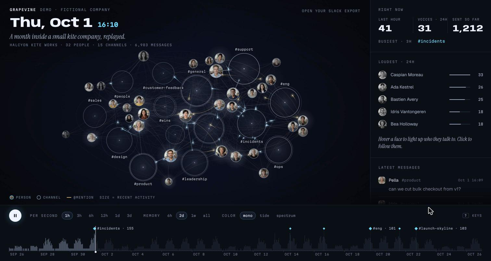
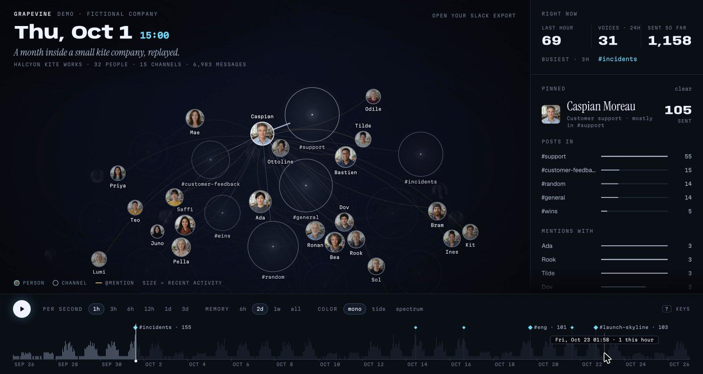

# grapevine

Replay a Slack workspace as a living graph. People are faces, channels are rings, and every message flies from the person who sent it to the channel it landed in. @mentions arc between people in amber. Things that go quiet shrink and fade, so the picture always shows who is active *right now* in the replay. Portraits sit in grayscale and warm into color the moment that person speaks.



It opens on a demo: a month at **Halcyon Kite Works**, a made-up company with 32 people, 15 channels and about 7,000 messages. Every name and message in the demo is invented, and the portraits are AI-generated (Grok Imagine 2, via [Luxin](https://luxin.sh)). None of them is a real person. You can drop in your own Slack export instead. It is read inside your browser tab and never uploaded anywhere.

## Run it

```bash
pnpm install
pnpm dev        # http://localhost:5173
```

`pnpm build` writes a static site to `dist/` that you can host anywhere (GitHub Pages, Netlify, an S3 bucket, or just `npx serve dist`). There is no server and no API.

Other scripts: `pnpm test` (Vitest), `pnpm typecheck`, `pnpm lint` (Biome).

## Controls

| | |
|---|---|
| `space` | play / pause |
| `←` `→` | step one hour (hold `shift` for a day) |
| `[` `]` | slower / faster (1 hour to 3 days of Slack per second) |
| `F` | re-center the camera after you pan or zoom |
| `esc` | clear the pinned node and fly back out |
| hover | light up a person or channel and everything it touches |
| click | pin it: the camera flies to its neighborhood, and the side panel shows who it talks to and what was said |
| timeline | hover to preview, click or drag to scrub. The diamonds mark bursts it found on its own; click one to jump there |
| memory | how fast activity fades: 6h, 2d, 1w, or never (cumulative) |
| color | mono (default), tide, or spectrum. Speed, memory and color are remembered in this browser |



## Use your own Slack export

1. A workspace admin exports data at **Workspace settings → Import/Export Data → Export**. You get a `.zip`.
2. Click **Open Slack export** or drag the zip onto the page.

The zip is unpacked and parsed in the browser with [fflate](https://github.com/101arrowz/fflate). The export itself never leaves the tab. The one network request is for profile photos: the export lists each person's photo as a link to Slack's image server, and the browser loads those links the same way Slack does. The app reads public and private channels, group DMs and DMs (whichever the export contains). It also keeps guests from shared channels who are missing from `users.json`, and it skips bots, joins and leaves.

`.gitignore` blocks `*.zip`, so an export dropped into the repo folder does not get committed by accident.

## How it works

```
Slack export (.zip)  ──►  data/slack-export.ts  ──►  Dataset (people, channels, sorted messages)
data/demo.ts writes a fake export ──┘                         │
                                                              ▼
                     engine/replay.ts   state at time t: per-node and per-edge activity
                                        with exponential decay (the "memory" half-life)
                                                              │
                     engine/layout.ts   d3-force simulation, ticked by the render loop
                     engine/player.ts   clock, speed, flights (messages in the air), focus,
                                        and a tiny store React subscribes to
                                                              │
                     render/renderer.ts Canvas 2D: edges, rings, comets, pulses, labels
                     ui/*.tsx           HUD, timeline, side rail (React 19)
```

A few decisions that make it feel right:

- **Time is the source of truth.** All state is a pure function of (dataset, t, half-life). Scrubbing backwards replays from the start, which takes about 10 ms on a 6-month, 38,000-message export. Rewinding cannot drift out of sync.
- **Decay instead of totals.** Each node and edge stores `(value, lastUpdated)` and decays lazily: `value × 2^(−Δt / halfLife)`. Size means momentum, not seniority.
- **Nodes are born, not loaded.** People and channels join the simulation the first time they speak, next to whatever they first connected to. The graph grows instead of popping in all at once.
- **The force sim is passive.** d3-force runs with its timer stopped and is ticked once per frame. Collision radii are refreshed as nodes grow, because d3 caches them otherwise.
- **Bursts are found, not hand-tagged.** `findMoments` scores 3-hour windows with a robust z-score (median and MAD) and keeps the top few, spaced apart.
- **The demo is real input.** `buildDemoExport` writes actual Slack-export JSON, which goes through the same parser as an upload. The demo exercises the real code path.

## Ideas if you want to take it somewhere

- Threads as their own edges, or reactions as a second signal
- Community detection (Louvain) to color teams instead of using each person's busiest channel
- Export a replay to video with `canvas.captureStream()` and `MediaRecorder`
- Swap Slack for another chat log: Discord, iMessage, email, GitHub PR reviews. Anything that is "who said something, where, when" fits `Dataset`
- WebGL (regl, PixiJS) if you want 10k+ nodes

## Layout

```
src/
  data/      types, Slack export parser, zip reader, fictional demo generator
  engine/    replay (time + decay), layout (d3-force), player (clock + store), palette
  render/    canvas renderer
  ui/        React components
  App.tsx    shell, keyboard, drag and drop
public/
  avatars/   AI-generated portraits of the fictional demo people
  favicon.svg
```

## License

MIT
